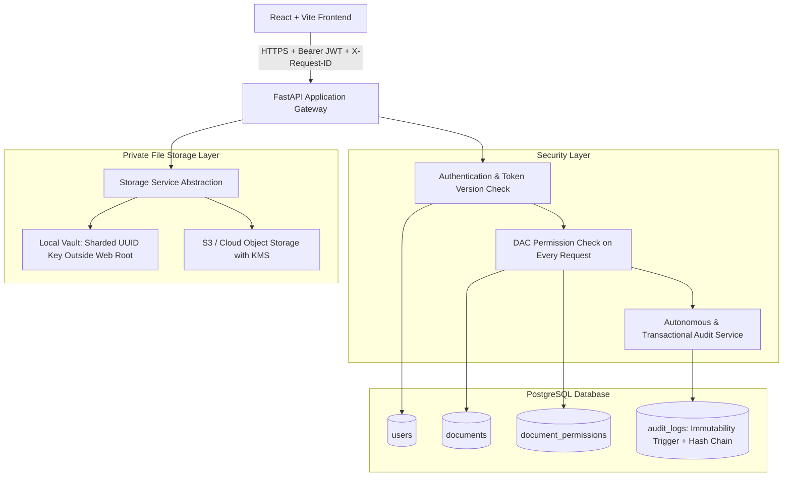

# TrustVault System Architecture

## 1. Architectural Overview

TrustVault is an enterprise-grade secure document-sharing platform engineered under **Zero-Trust** and **Least-Privilege** security paradigms.



---

## 2. Component Design & Directory Structure

```
TrustVault/
├── backend/
│   ├── alembic/              # Database schema migrations
│   ├── app/
│   │   ├── api/
│   │   │   ├── deps.py       # Authentication, token_version & role dependencies
│   │   │   └── v1/
│   │   │       ├── endpoints/# Auth, users, documents, permissions, audit
│   │   │       └── router.py # Combined API router
│   │   ├── core/
│   │   │   ├── config.py     # Pydantic Settings & environment validation
│   │   │   ├── database.py   # Separated app and admin async engines
│   │   │   └── security.py   # Argon2id hashing & JWT cryptographic operations
│   │   ├── models/           # SQLAlchemy 2.0 ORM models
│   │   ├── schemas/          # Pydantic v2 validation models
│   │   ├── services/         # AuditService, DocumentService, StorageService
│   │   └── main.py           # Application entrypoint & health checks
│   ├── tests/                # Automated pytest security & regression suite
│   └── requirements.txt      # Pinned backend dependencies
├── frontend/                 # React + Vite application (Vanilla CSS design system)
├── storage_vault/            # Private local storage (outside web root)
├── docs/
│   ├── ARCHITECTURE.md       # Architectural specifications
│   └── API.md                # REST API documentation
├── THREATS.md                # STRIDE threat model & test mapping
├── SECURITY.md               # Vulnerability reporting & security policies
├── PROMPTS.md                # Verifiable AI interaction log
└── README.md                 # Setup, verification, and operation manual
```

---

## 3. Database Schema & Role Separation

### Database Privilege Separation
TrustVault enforces database role privilege separation:
- **`trustvault_admin`**: DDL owner. Executes Alembic schema migrations, creates tables, and configures triggers.
- **`trustvault_app`**: Least-privilege runtime role used by the FastAPI application.
  - Granted `SELECT, INSERT, UPDATE, DELETE` on `users`, `documents`, and `document_permissions`.
  - Granted strictly `INSERT, SELECT` on `audit_logs`.
  - **Explicitly revoked** `UPDATE, DELETE, TRUNCATE` on `audit_logs`.
  - Cannot alter triggers, drop tables, or modify schema.

### Tables
1. **`users`**: UUID primary key, unique email, Argon2id password hash, role (`admin`/`user`), `token_version` (integer), and `is_active` boolean.
2. **`documents`**: High-entropy `storage_key` (UUIDv4), owner FK, category, content SHA-256 integrity digest, MIME type, and sanitized filename.
3. **`document_permissions`**: Explicit DAC table with unique constraint `(document_id, user_id)` and permission levels (`view`, `edit`).
4. **`audit_logs`**: Correlation `request_id`, actor details, client IP, action, target, result (`SUCCESS`/`DENIED`/`ERROR`), metadata JSONB, `prev_hash`, and `record_hash`.

---

## 4. Authentication & Immediate Revocation Guarantees

### Server-Side Validation on Every Request
1. **Zero Client Trust**: User IDs, document permissions, and roles passed by clients are never trusted.
2. **Token Version Verification**: Every incoming request extracts the JWT `token_version` claim and compares it to `users.token_version` in the database.
3. **Immediate Revocation**:
   - Calling `/api/v1/auth/logout` increments `token_version`.
   - Admin deactivating a user via `/api/v1/users/{id}/status` increments `token_version` and sets `is_active=False`.
   - All subsequent requests bearing previous tokens are rejected with `HTTP 401 Unauthorized`.
4. **Behavior of In-Progress Downloads During Revocation**:
   - An in-flight HTTP chunked download that has already passed authorization will finish transmitting data buffered in socket memory.
   - However, **any subsequent byte chunk request, pagination query, or new download request is rejected immediately** upon the next authorization check.

---

## 5. Private File Storage Design

1. **Isolation Outside Web Root**: Files reside in `storage_vault/`, completely isolated from any public web server routing.
2. **Randomized Storage Keys**: Files on disk are named strictly by cryptographic UUIDs (`<uuid>.bin`). Original client filenames are stored only as display metadata in the database, eliminating path traversal (`../../etc/passwd`) and null-byte injection.
3. **Directory Sharding**: Storage keys are distributed into a two-level prefix directory tree (e.g., `storage_vault/ab/cd/<uuid>.bin`) to prevent filesystem performance degradation.
4. **Streaming Verification**: File size is tracked during upload streaming; uploads exceeding `MAX_UPLOAD_SIZE_BYTES` are aborted with `HTTP 413 Payload Too Large`. Magic bytes are verified before persisting.

---

## 6. Audit-Integrity & Concurrency-Safe Hash Chaining

### Immutability Trigger
A PostgreSQL `BEFORE UPDATE OR DELETE` trigger aborts any modification of `audit_logs` rows:
```sql
CREATE OR REPLACE FUNCTION trg_prevent_audit_log_modification()
RETURNS TRIGGER AS $$
BEGIN
    RAISE EXCEPTION 'Audit logs are immutable. UPDATE and DELETE operations are strictly prohibited.';
END;
$$ LANGUAGE plpgsql;
```

### Concurrency-Safe Hash Chain
Each audit row calculates:
$$\text{record\_hash} = \text{SHA256}(\text{prev\_hash} \parallel \text{timestamp} \parallel \text{request\_id} \parallel \text{actor\_id} \parallel \text{action} \parallel \text{target\_type} \parallel \text{target\_id} \parallel \text{result} \parallel \text{denial\_reason} \parallel \text{metadata})$$

To guarantee chain continuity under concurrent requests:
1. The transaction acquires a PostgreSQL advisory transaction lock (`SELECT pg_advisory_xact_lock(748192837);`).
2. The latest committed `record_hash` is retrieved.
3. The new `record_hash` is computed and inserted.
4. The lock automatically releases upon transaction commit.

### Limitations & External Anchoring
- **Local Superuser Limitation**: A PostgreSQL `SUPERUSER` or OS root administrator can disable triggers or alter raw data files on disk.
- **Production Defense**: For true tamper-proof retention, local audit records should be mirrored in real-time to an external write-once-read-many (WORM) storage sink (such as AWS CloudWatch with Object Lock, S3 Glacier Vault Lock, or an enterprise SIEM).
